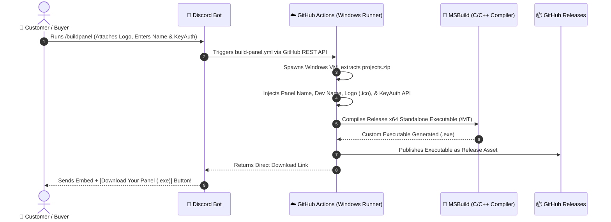

# Complete Setup Guide: Auto Custom Panel Maker & KeyAuth Builder 🚀

This guide explains step-by-step how to set up the **Auto Custom Panel Maker**, connect it to your GitHub repository and Discord server, and start selling custom panels that compile automatically!

---

## 📌 How the Entire System Works



---

## 1️⃣ Step 1: Create Your GitHub Repository

1. Go to [GitHub.com](https://github.com/new) and create a new repository (e.g. `Auto-Custom-Panel-Maker`).
   - You can make it **Private** or **Public**.
2. Push or upload the files from this directory to your new repository:
   - Make sure `.github/workflows/build-panel.yml` is in the repository!
   - Make sure `scripts/patch_and_build.py` is present.
   - Make sure `projects.zip` (or `project_template/`) is present.
3. Enable GitHub Actions permissions:
   - Go to your repository **Settings** -> **Actions** -> **General**.
   - Under **Workflow permissions**, select **"Read and write permissions"** and check **"Allow GitHub Actions to create and approve pull requests"**.
   - Click **Save**.

---

## 2️⃣ Step 2: Create a GitHub Personal Access Token (PAT)

Your Discord bot uses this token to trigger the build workflow:

1. Go to [GitHub Token Settings](https://github.com/settings/tokens).
2. Click **Generate new token (classic)**.
3. Name it: `AutoPanelBot`.
4. Set Expiration to **No expiration** (or your preference).
5. Check the following scopes:
   - ✅ **`repo`** (Full control of private repositories)
   - ✅ **`workflow`** (Update and trigger GitHub Action workflows)
6. Click **Generate token** and copy it (starts with `ghp_...`).

---

## 3️⃣ Step 3: Create Your Discord Bot

1. Go to the [Discord Developer Portal](https://discord.com/developers/applications).
2. Click **New Application** -> Name it (e.g., `Custom Panel Builder`).
3. Go to the **Bot** tab on the left:
   - Click **Reset Token** and copy the **Bot Token**.
   - Scroll down to **Privileged Gateway Intents**:
     - Enable **Server Members Intent**
     - Enable **Message Content Intent**
4. Go to **OAuth2** -> **URL Generator**:
   - Scopes: check `bot` and `applications.commands`.
   - Bot Permissions: check `Send Messages`, `Embed Links`, `Attach Files`, `Use Slash Commands`.
   - Copy the generated URL and open it in your browser to invite the bot to your Discord server!

---

## 4️⃣ Step 4: Configure the Bot `.env` File

Inside either the `bot/` folder (for Python) or `bot_nodejs/` folder (for Node.js), create a file named `.env`:

```env
# Discord Bot Token (from Step 3)
DISCORD_TOKEN=MTIzNDU2Nzg5MDEyMzQ1Njc4...

# GitHub Personal Access Token (from Step 2)
GITHUB_TOKEN=ghp_xxxxxxxxxxxxxxxxxxxx

# Your GitHub Repository (username/repo_name)
GITHUB_REPO=your_username/your_repo_name

# Workflow filename (keep as build-panel.yml)
GITHUB_WORKFLOW=build-panel.yml

# Optional Discord Webhook URL for channel announcements
DISCORD_WEBHOOK_URL=

# Require License Key? ('true' to require purchase, 'false' for free builds)
REQUIRE_LICENSE_KEY=true

# Your Discord User ID (Admin ID, can generate license keys)
ADMIN_USER_IDS=123456789012345678
```

---

## 5️⃣ Step 5: Start Your Discord Bot

You have two bot options: **Python** or **Node.js**. Use whichever you prefer!

### Option A: Running the Python Bot (`bot/`)
```bash
cd bot
pip install -r requirements.txt
python bot.py
```

### Option B: Running the Node.js Bot (`bot_nodejs/`)
```bash
cd bot_nodejs
npm install
npm start
```

---

## 6️⃣ Step 6: Selling & Customer Workflow

### As the Seller (Admin):
1. In your Discord server, run:
   ```
   /generatekey credits:1 note:"Buyer: JohnDoe"
   ```
2. The bot will give you an exclusive key like: `PANEL-A8F2-9XQ1-M4K7`.
3. Give this key to your customer when they buy from you (or automate it via Sellix/Sellauth webhook).

### As the Buyer (Customer):
1. The buyer runs:
   ```
   /redeem key:PANEL-A8F2-9XQ1-M4K7
   ```
2. The bot credits 1 build credit to their account.
3. The buyer triggers the build:
   ```
   /buildpanel
   ```
   *(They can optionally drag & drop their custom logo image into the command!)*
4. A popup modal appears asking for:
   - **Panel Name** (e.g., `Apex Predator Loader`)
   - **Developer Name** (e.g., `Vibin Mods`)
   - **KeyAuth App Name**
   - **KeyAuth Owner ID**
   - **KeyAuth Secret**
5. When they hit **Submit**:
   - GitHub Actions spins up a Windows runner.
   - Converts the logo into a multi-resolution Windows `.ico`.
   - Injects credentials into `config.h`.
   - Compiles a standalone x64 release `.exe`.
   - The bot replies with a direct download button: `[ ⬇️ Download Your Panel (.exe) ]`!

---

## 7️⃣ Step 7: How to Upload Your Own Custom C/C++ Panel Project

If you have your own C or C++ custom panel code that you want to sell:

1. In your C/C++ source code, use the following placeholder strings where appropriate:
   - `"__PLACEHOLDER_PANEL_NAME__"` -> Where panel name should be
   - `"__PLACEHOLDER_DEV_NAME__"` -> Where developer name should be
   - `"__PLACEHOLDER_KEYAUTH_NAME__"` -> KeyAuth app name
   - `"__PLACEHOLDER_KEYAUTH_OWNERID__"` -> KeyAuth owner ID
   - `"__PLACEHOLDER_KEYAUTH_SECRET__"` -> KeyAuth secret
   - `"__PLACEHOLDER_KEYAUTH_VERSION__"` -> KeyAuth version
   - Name your application icon file `app.ico`.
2. Pack your project into `projects.zip` by running:
   ```powershell
   powershell -ExecutionPolicy Bypass -File .\scripts\pack_template.ps1 -SourceFolder "path/to/your/custom_project"
   ```
3. Commit and push `projects.zip` to your GitHub repository!
4. Whenever a customer builds, the GitHub Actions runner will automatically extract `projects.zip`, patch it, compile it, and deliver the customized `.exe`!
